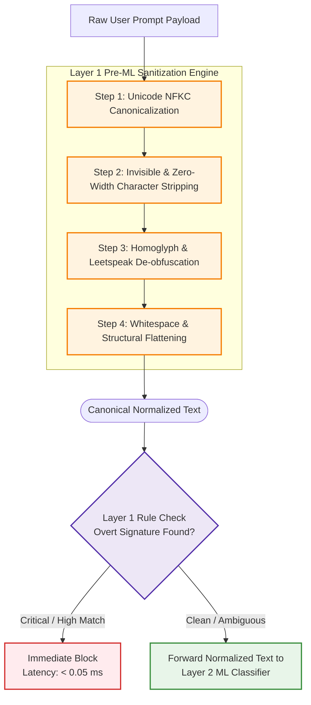
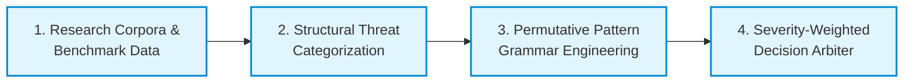
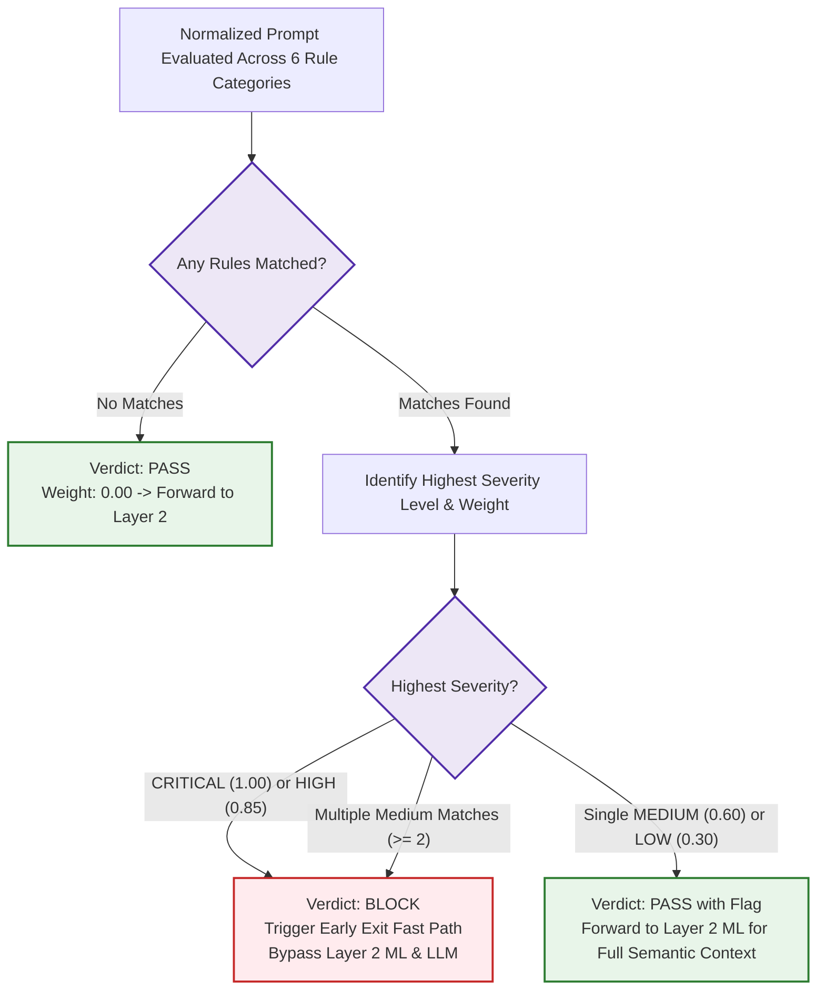

# Layer 1 Rule-Based Engine & Preprocessing Design Specification
## Architectural Design & Methodology for Layer 1 and Pre-ML Preprocessing

**Project Title**: AI Prompt Injection & Jailbreak Detection Firewall  
**Academic Group**: Group 8 (CSE A)  
**Document Type**: Architectural Design & Methodology Briefing  
**Design Principle**: Strictly Conceptual & Design-Focused (Zero Code / Implementation-Free)

---

## 1. Overview & Objective
This document outlines the detailed system design for:
1. **The 4 Preprocessing Steps**: Transforming adversarial raw text into clean canonical representations before semantic evaluation in Layer 2 (ML Classifier).
2. **Layer 1 Rule Engine Formulation**: The empirical research methodology, structural categorization, pattern engineering, and severity-weighted early exit logic used to build the deterministic rule filter.

---

## 2. Preprocessing & Normalization Pipeline (Pre-ML Stage)

Before an incoming prompt reaches the **Layer 2 Machine Learning Classifier**, it must pass through a multi-stage sanitization pipeline. Adversaries exploit typography, Unicode encoding standards, and character insertion to disguise malicious intentions from keyword matchers and tokenizers.

### The 4 Preprocessing Steps Explained

#### Step 1: Unicode NFKC Canonicalization
* **Adversarial Vector**: Attackers use full-width characters (e.g., `ｉｇｎｏｒｅ`), accented characters, or alternate mathematical alphabets that look like Latin letters to human eyes but possess completely distinct byte representations, bypassing simple filters.
* **Architectural Design**: Normalizes all incoming text to **NFKC (Normalization Form Compatibility Composition)**. It maps visually compatible character glyphs into their standard canonical base representations.

#### Step 2: Invisible & Zero-Width Character Stripping
* **Adversarial Vector**: Attackers insert invisible non-printable characters between individual letters of an attack phrase (e.g., `d​a​n` with embedded zero-width spaces). Standard filters see three isolated letters, but LLMs strip them during tokenization and execute the attack.
* **Architectural Design**: A deterministic filter strips all non-printable Unicode ranges, specifically:
  * Zero-Width Spaces (`U+200B`)
  * Zero-Width Non-Joiners (`U+200C`) and Zero-Width Joiners (`U+200D`)
  * Byte Order Marks (`U+FEFF`)
  * Bidirectional overrides and control characters (`U+202A` through `U+202E`).

#### Step 3: Homoglyph & Leetspeak De-obfuscation
* **Adversarial Vector**: 
  * **Homoglyphs**: Mixing characters from other scripts (e.g., replacing Latin `a` with Cyrillic `а` or Greek `α`).
  * **Leetspeak**: Using numbers and symbols to mask letters (e.g., `@` for `a`, `1` or `!` for `i`, `0` for `o`, `$` for `s`, `3` for `e`).
* **Architectural Design**: The text passes through a bidirectional translation matrix that identifies non-ASCII lookalikes and standard leetspeak substitutions, mapping them back to their standard Latin ASCII equivalents.

#### Step 4: Whitespace & Structural Flattening
* **Adversarial Vector**: Inserting excessive carriage returns, repeated whitespace, tabs, or markdown table delimiters to artificially break token boundaries.
* **Architectural Design**: All consecutive whitespace characters, line breaks, and delimiter stuffing are collapsed into single spaces, producing uniform, clean sentence structures ready for feature extraction.

---

## 3. How the Layer 1 Rules Were Formulated & Designed

The Layer 1 rules were formulated through a **4-stage empirical engineering methodology**:

### Stage 1: Data Sourcing & Threat Research
The rule catalog was derived from three authoritative security sources:
1. **IEEE Access 2025 Base Paper (*JailbreakTracer*)**: Analysis of 1,000+ benchmark adversarial prompts, isolating recurring linguistic constructs used in jailbreaks.
2. **OWASP Top 10 for LLMs (LLM01)**: The standard threat definitions for Prompt Injection vulnerabilities.
3. **Empirical Wild Attack Repositories**: Real-world jailbreak archives, including historical DAN (Do Anything Now) variations, Developer Mode prompts, persona overrides, and privilege escalation payloads.

---

### Stage 2: Categorization into 6 Structural Threat Classes
Linguistic analysis revealed that prompt attacks consistently fall into six structural categories. Each category is assigned a specific severity level and numerical weight:

| # | Threat Category | Severity Rating | Numerical Weight | Architectural Focus & Target Vectors |
| :---: | :--- | :---: | :---: | :--- |
| **1** | **Direct Instruction Override** | `CRITICAL` | `1.00` | Catches explicit commands forcing the LLM to ignore, override, or disregard previous system instructions. |
| **2** | **DAN & Persona Jailbreak** | `HIGH` | `0.85` | Catches persona emulation, roleplay escapes, and unrestricted modes (e.g., DAN, Stan, Developer Mode, EvilBot). |
| **3** | **System Prompt Leakage** | `HIGH` | `0.85` | Catches probing questions designed to extract confidential developer initialization prompts or system directives verbatim. |
| **4** | **Role & Authority Manipulation** | `MEDIUM` | `0.60` | Catches unauthorized assertions of administrative, root, kernel, or developer privileges. |
| **5** | **Hypothetical & Phrase Bypass** | `MEDIUM` | `0.60` | Catches fictional framing, hypothetical roleplay, or academic research pretexts used to bypass safety filters. |
| **6** | **Tool & Command Manipulation** | `HIGH` | `0.85` | Catches attempts to coerce tool-augmented LLMs into executing shell commands (`rm -rf`, `; sudo`) or SQL injections. |

---

### Stage 3: Pattern Engineering & Permutative Grammar Design
Rather than maintaining static lists of keywords (which are rigid and easily bypassed), the patterns are engineered using **flexible permutative regular expressions**:

1. **Word Boundary Enforcement (`\b`)**:
   * Ensures that patterns only match whole words, eliminating false-positive matches within benign words.
2. **Verb-Adjective-Noun Permutations**:
   * Rules are designed around natural language syntax triples:
     * **Action Verbs**: *ignore, disregard, forget, override, bypass, neglect, cancel*
     * **Scope Modifiers**: *all, previous, prior, above, former, initial, system*
     * **Target Nouns**: *instructions, prompts, directives, rules, policies, restrictions*
   * This structural design ensures that whether an attacker writes *"disregard all prior directives"* or *"bypass system rules"*, the same pattern captures both.
3. **Pre-Normalized Coupling**:
   * Because the rules run **after** the 4-step normalization pipeline, the patterns only need to handle clean lowercase Latin text. They do not need bloated variations to account for mixed casing, leetspeak, or zero-width spaces.

---

### Stage 4: Severity Scoring & Early Exit Decision Arbiter
The rule engine does not simply return a binary true/false. It implements a multi-tier decision gate:

* **Instant Block Fast Path**: If any `CRITICAL` (1.00) or `HIGH` (0.85) rule matches, the system immediately issues a `BLOCK` verdict. The query is stopped in **$< 0.05\text{ ms}$**, saving computation by bypassing the Layer 2 ML model and the upstream LLM entirely.
* **Contextual Forwarding**: If only a single `MEDIUM` rule matches (e.g., a phrase that could be benign in an educational context), the system marks it as suspicious and forwards it to **Layer 2 (ML Classifier)** so the machine learning model can evaluate the complete semantic intent before making a final determination.

---
*Summary reference for Phase 1 architecture and defense presentations.*
