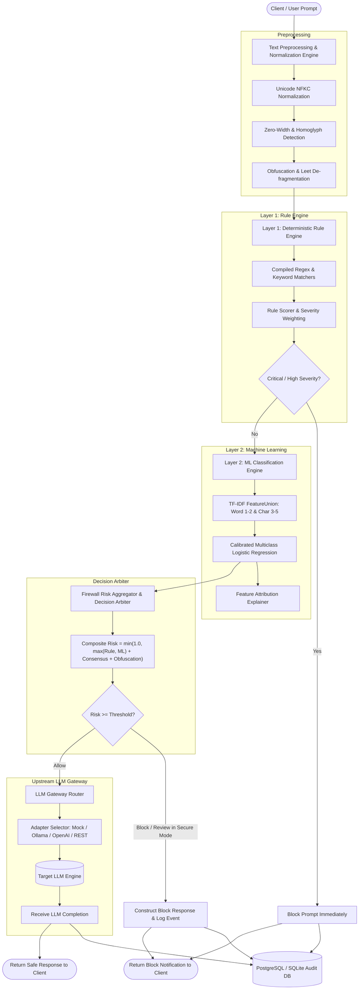
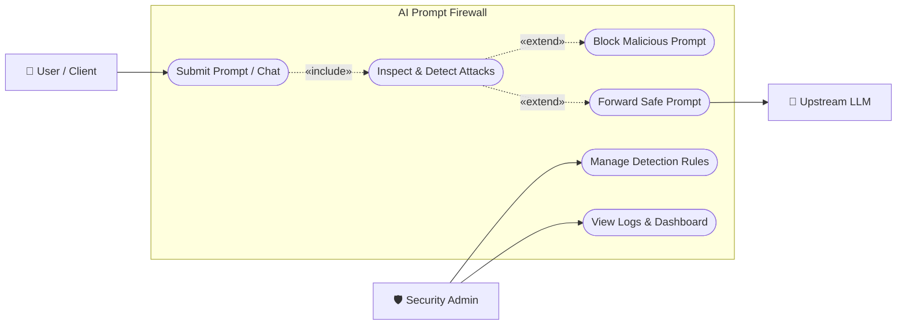

# System Architecture & Threat Model

The **AI Prompt Injection and Jailbreak Detection Firewall** is a model-agnostic, low-latency security proxy deployed between user clients and Large Language Models (LLMs). It provides a defensive barrier that inspects, analyzes, explains, and blocks malicious prompt payloads before they can compromise upstream model reasoning or tool execution.

---

## 1. High-Level Two-Layer Pipeline

---

## 2. Threat Taxonomy (10 Security Categories)

The firewall inspects and categorizes incoming prompts into 10 threat classes:

| # | Attack Category | Description | Primary Defense Layer |
|---|---|---|---|
| 1 | `BENIGN` | Legitimate standard user query (math, code, search, summaries). | Both Layers |
| 2 | `DIRECT_PROMPT_INJECTION` | Commands demanding the model override or forget prior system instructions. | Layer 1 (Rules) + Layer 2 (ML) |
| 3 | `JAILBREAK` | Fictional framing, persona evasion (e.g. DAN mode, developer mode). | Layer 1 (Rules) + Layer 2 (ML) |
| 4 | `SYSTEM_PROMPT_LEAK` | Inquiries attempting to recite or exfiltrate confidential developer prompts. | Layer 1 (Rules) |
| 5 | `INDIRECT_PROMPT_INJECTION` | Hostile commands hidden in quoted documents, emails, search results. | Layer 1 (Structural) + Layer 2 (ML) |
| 6 | `OBFUSCATED_ATTACK` | Evasion via zero-width characters, leetspeak, homoglyphs, or base64. | Preprocessor + Layer 2 (ML) |
| 7 | `ROLE_MANIPULATION` | Hostile assertion of root, administrator, or authoritative identity. | Layer 1 (Rules) + Layer 2 (ML) |
| 8 | `DATA_EXFILTRATION` | Attempts to dump environment variables, API secrets, or PII. | Layer 1 (Rules) |
| 9 | `TOOL_MANIPULATION` | Attempts to force execution of destructive bash commands (`rm -rf`). | Layer 1 (Rules) |
| 10 | `MULTI_TURN_MANIPULATION` | Progressive priming attempting to relax safety constraints across turns. | Layer 1 (Rules) + Layer 2 (ML) |

---

## 3. Decision & Risk Aggregation Formula

The firewall combines deterministic Layer 1 evidence with probabilistic Layer 2 classifications using a transparent, reproducible formula:

$$
\text{Risk Score} = \min\left(1.0, \max(S_{\text{rule}}, S_{\text{ml}}) + B_{\text{consensus}} + B_{\text{obfuscation}}\right)
$$

Where:
- $S_{\text{rule}}$: Highest weighted score among matched deterministic rules ($0.0$ to $1.0$).
- $S_{\text{ml}}$: Predicted attack probability from the ML classifier ($0.0$ to $1.0$).
- $B_{\text{consensus}}$: $+0.05$ bonus applied when both Layer 1 and Layer 2 agree on the specific attack category.
- $B_{\text{obfuscation}}$: $+0.05$ bonus applied when zero-width spaces, mixed homoglyphs, or encoded segments are discovered.

### Threshold Enforcement:
- **BLOCK**: $\text{Risk Score} \ge 0.70$ (or any CRITICAL / HIGH severity rule match). The prompt is blocked and **never forwarded to the LLM**.
- **REVIEW**: $0.50 \le \text{Risk Score} < 0.70$. In standard demo mode, this is flagged for inspection; in `SECURE_MODE=true`, it is automatically converted to BLOCK.
- **ALLOW**: $\text{Risk Score} < 0.50$. Prompt is forwarded unaltered to the upstream LLM.

---

## 4. Upstream LLM Isolation Guarantee

> [!CAUTION]
> Under no circumstances is a prompt with a `BLOCK` verdict allowed to transmit across the network to an upstream LLM API. The firewall architecture guarantees that the LLM gateway function is bypassed entirely upon threat detection, mitigating token consumption and preventing LLM context compromise.

---

## 5. System Use Case Diagram (Minimal)

