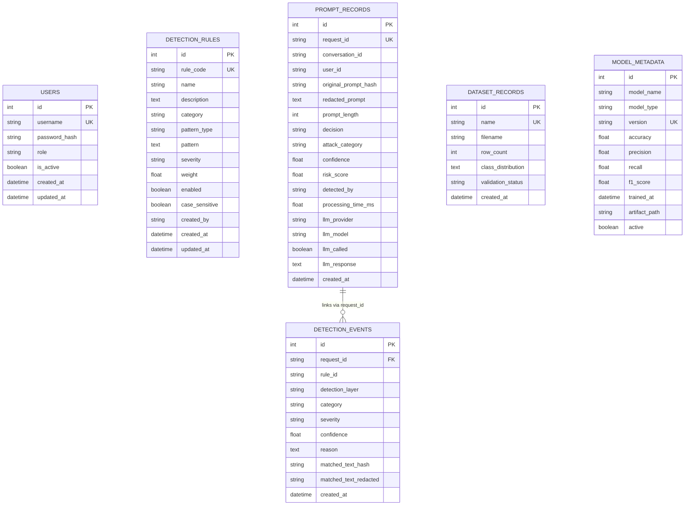

# Database Schema & Entity Relationships

The AI Prompt Firewall utilizes **SQLAlchemy ORM** supporting SQLite for local zero-dependency execution and PostgreSQL for multi-container production deployments.

---

## 1. Entity-Relationship Diagram

---

## 2. Table Specifications

### `users`
Stores administrator accounts authorized to manage detection rules, review datasets, and configure threshold parameters.
- **Indexes**: `username` (Unique)

### `detection_rules`
Defines Layer 1 deterministic pattern signatures.
- **Indexes**: `rule_code` (Unique), `category`, `enabled`

### `prompt_records`
Core immutable audit ledger logging every evaluated prompt transaction, calculated risk score, detection attribution, and upstream response metadata.
- **Indexes**: `request_id` (Unique), `decision`, `attack_category`, `detected_by`, `created_at`

### `detection_events`
Detailed breakdown of specific rule triggers or ML classification evidence associated with a given `request_id`.

### `model_metadata`
Versioned metadata registry recording accuracy, precision, recall, and F1-score across trained classification iterations.
