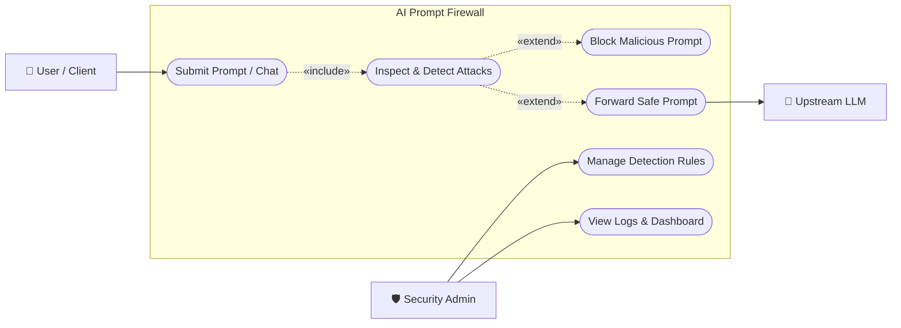
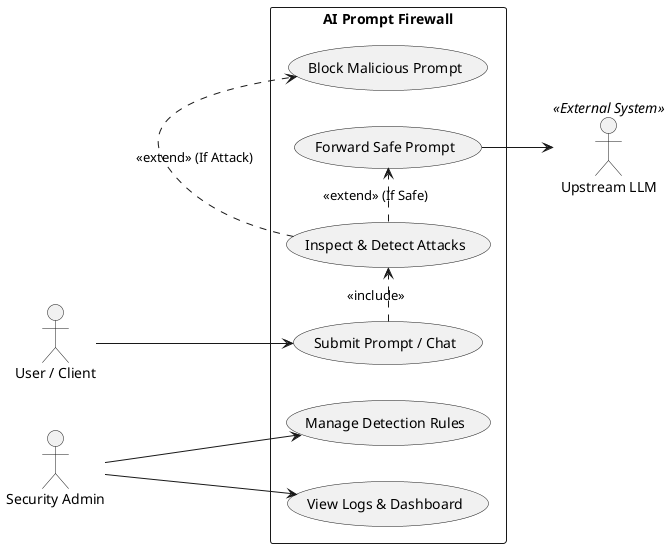

# AI Prompt Injection & Jailbreak Firewall - Use Case Diagram (Minimal)

---

## 1. Minimal Use Case Diagram (Mermaid)

---

## 2. Minimal PlantUML Code (For Slides & Report)

---

## 3. Core Summary

| Actor | Action / Use Case | Purpose |
|---|---|---|
| **User / Client** | **Submit Prompt / Chat** | Sends prompt or chat message to the application. |
| **Firewall (System)** | **Inspect & Detect Attacks** | Evaluates prompt through Rule Engine (L1) and ML Classifier (L2). |
| **Firewall (System)** | **Block Malicious Prompt** | Blocks threat and stops prompt from reaching upstream LLM. |
| **Firewall (System)** | **Forward Safe Prompt** | Forwards benign prompt to Upstream LLM and returns completion. |
| **Security Admin** | **Manage Detection Rules** | Creates, modifies, and toggles regex detection rules. |
| **Security Admin** | **View Logs & Dashboard** | Monitors real-time attack metrics, latency, and audit logs. |
